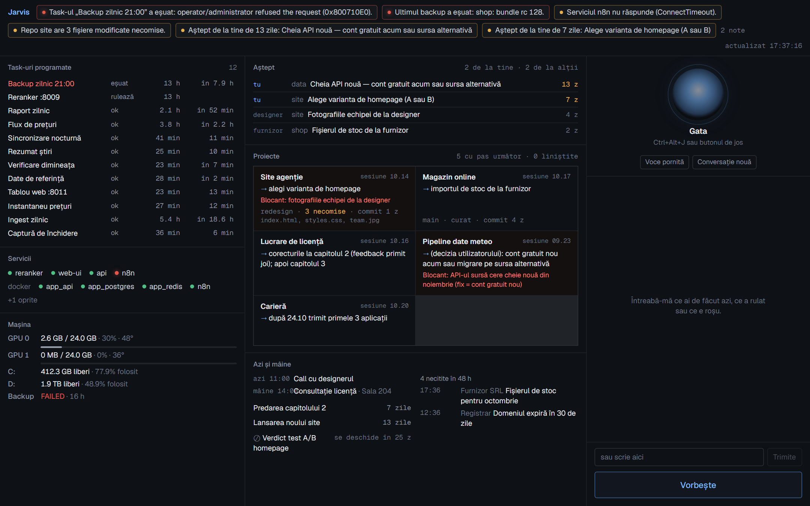

# local-ops-assistant ("Jarvis")

**A desktop board that watches everything I run on my machine, plus a push-to-talk voice assistant in Romanian that answers questions about it.** It has run every day at logon on my Windows workstation since September 2026.



*Screenshot from demo mode: all projects, tasks and messages are invented.*

## Why I built it

I run scheduled data pipelines, Docker services, local AI models and several side projects. Checking "did last night's job run, is the backup OK, what is waiting on me" meant opening five tools. This puts it on one screen, raises alerts by itself, and lets me ask out loud — *"ce e roșu?"* ("what's red?") — while I'm doing something else.

## What is interesting about it

- **Most questions never reach the LLM.** A deterministic fast path (`jarvis/fastpath.py`) answers the everyday questions — what is red, what is waiting on me, deadlines, what's on tomorrow — straight from the snapshot, in well under a second and at no cost. Anything it does not fully cover ("why", "explain", or a part no rule matches) goes to Claude. A wrong fast answer is worse than a slow one, so the matcher refuses partial matches.
- **The LLM can look but not touch.** The brain is Claude Code in headless mode (`claude -p --output-format stream-json`) with `--strict-mcp-config`: only a notes server and a read-only database server are allowed, edit/write/agent tools are explicitly disallowed, and there is no network tool — mail and calendar text reach the prompt, so an injected instruction must have nowhere to send data.
- **Loopback is not treated as a security boundary.** Any web page open in a browser can send requests to `127.0.0.1`, so every API route and the WebSocket require a per-launch token. The backend writes it to a local file; the Electron main process reads it and passes it to the window through the preload bridge. A web page cannot read that file.
- **One failing source never takes the board down.** Each collector (`jarvis/collectors/*`) is a pure parser plus a small `fetch()`, run on its own interval. A failure is recorded next to the last good value instead of replacing it.
- **Alerts are plain rules over the snapshot** (`jarvis/alerts.py`): failed or stale scheduled tasks, watched containers down, backup failed or too old, services not answering, uncommitted work in repos that should be clean, decisions waiting on me for more than a week.
- **Voice runs locally.** Speech-to-text is faster-whisper large-v3 on the GPU (≈1–1.5 s for a sentence); replies are spoken sentence by sentence with edge-tts while the rest of the answer is still streaming.
- **Session hand-off.** Other coding sessions write what they are waiting on into a small YAML queue; the board shows it and the assistant reads it out. Every spoken exchange is appended to a daily journal those sessions can read back.

Measured on my machine: Claude answers in 4–9 s for about $0.09–0.17 per question (one turn); fast-path answers are effectively instant.

## Architecture

```
 collectors (one per source, own interval)          app/ (Electron + React 19 + Vite + TS)
  scheduled tasks · docker · gpu · services   ──▶   board panels  ◀── WebSocket: snapshot on every change
  disk · backup · git · projects · calendar         voice panel   ──▶ /api/stt  (faster-whisper, GPU)
  mail · deadlines · pending queue · notes                        ──▶ /api/ask  (SSE: fast path or Claude)
            │                                                     ◀── /api/tts  (edge-tts, per sentence)
            ▼
 jarvis/snapshot.py  ── in-memory snapshot ──▶ jarvis/alerts.py (rules) ──▶ FastAPI on 127.0.0.1:8020
```

## Run the demo

The demo serves a canned snapshot built from synthetic data and test fixtures; no collector touches your machine.

```bash
uv sync --extra dev
uv run python demo/build_demo.py                  # demo/workspace -> demo/snapshot.json
JARVIS_DEMO=demo/snapshot.json uv run python -m jarvis.server
cd app && npm install && npm run build && npm start
```

Typed questions work without a microphone. The fast-path questions ("ce aștepți de la mine?", "ce e roșu?", "ce termene am?") answer without Claude; anything else needs the Claude Code CLI installed and logged in.

## Run it for real

- Edit `config/jarvis.yaml`: paths to your projects table and notes, the scheduled-task name pattern, services, watched containers, repos.
- Optional `config/secrets.yaml` (from `secrets.example.yaml`): a private calendar ICS URL and a read-only mail app password. Without them those panels say "not configured" and everything else works.
- `config/mcp.json`: the MCP servers the brain may use (read-only).
- `scripts/register_tasks.ps1` registers the backend and the window to start at logon.

Platform notes: the scheduled-task collector uses PowerShell's `Get-ScheduledTask` (Windows), and voice expects an NVIDIA GPU. The UI and all spoken output are in Romanian.

## Tests

```bash
uv run pytest            # 67 tests: parsers, alert rules, fast path, brain prompt, API/WebSocket token check
cd app && npx vitest run # 7 tests: SSE parsing, formatting, alert bar
```

## Built with

Python, FastAPI, asyncio, faster-whisper, edge-tts, Claude Code (headless), Electron, React, TypeScript, Vite. Designed and built by me with Claude Code as a coding assistant.

## License

MIT
